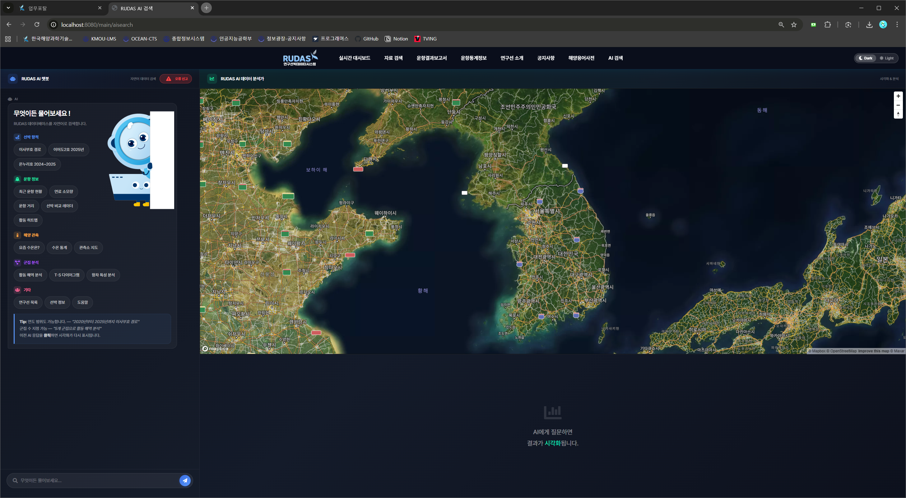
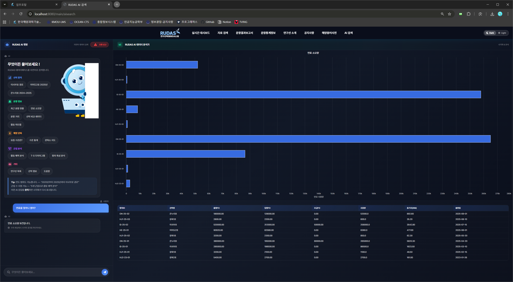
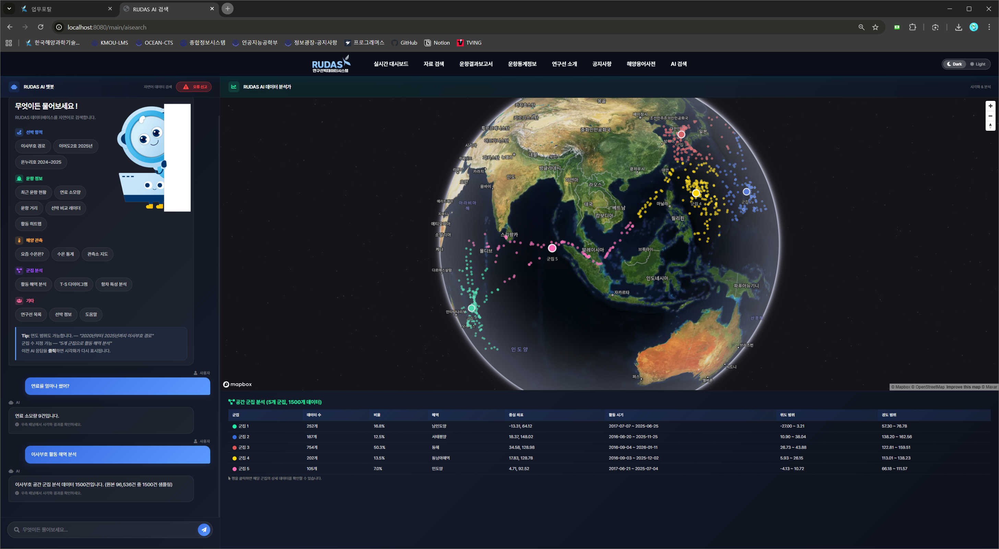
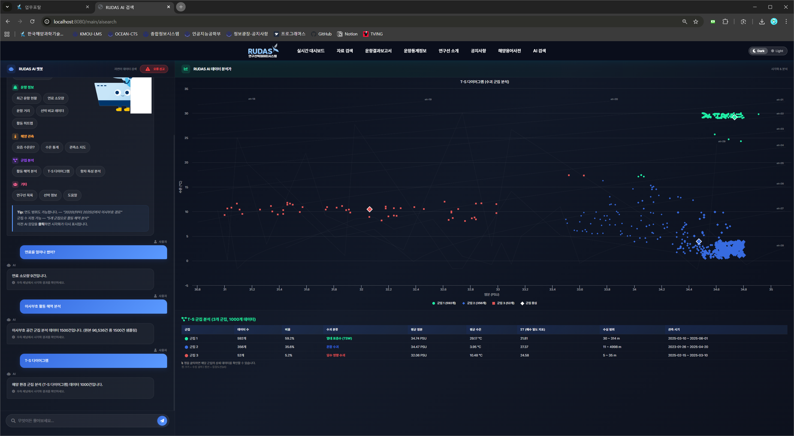
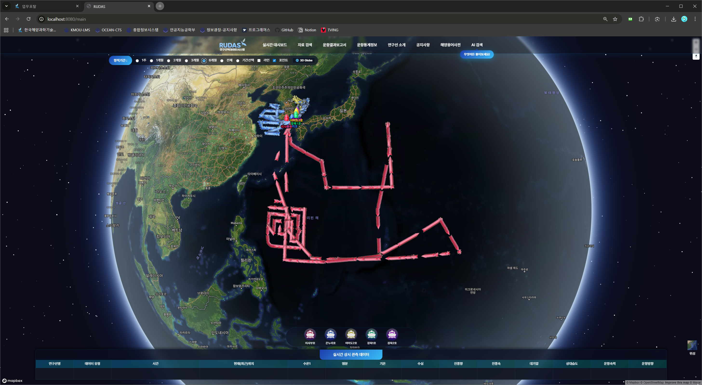
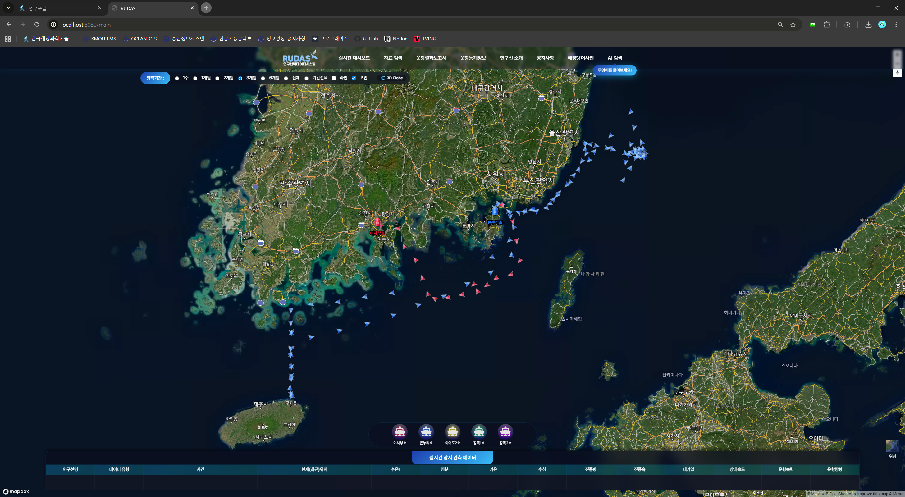
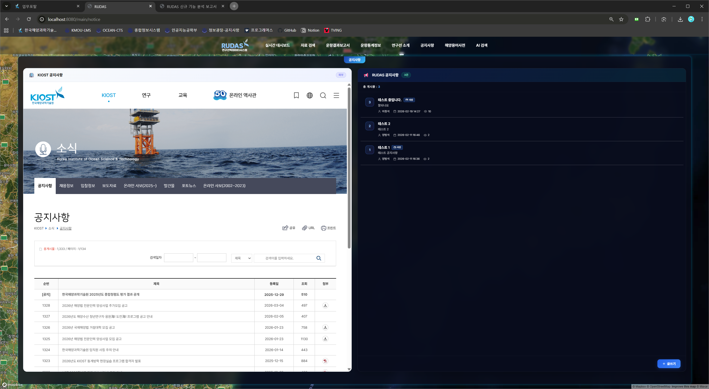

# RUDAS

**Research vessel Underway Data Acquisition System**

한국해양과학기술원(KIOST) 해양빅데이터·AI센터가 운영하는 연구선 실시간 해양 공간 자료 수집 시스템. 현장실습 기간에 자연어 질의(Text-to-SQL) 엔진 / 군집 분석 / 3D 지도 시각화 / 대용량 조회 최적화를 설계하고 구현했습니다.

> 2026.01 ~ 2026.05 현장실습 프로젝트
> 연구 결과는 KCI 등재 학술지에 제1저자로 게재: 양범석·이철용, "규칙 기반 Text-to-SQL을 활용한 해양 공간 빅데이터 자연어 질의 시스템 설계 및 구현", 한국지리정보학회지 29(2), 2026, pp.152-169. https://doi.org/10.11108/kagis.2026.29.2.152

---

## Overview

RUDAS는 KIOST 연구선(이사부호, 온누리호, 이어도2호, 장목1호, 장목2호)이 수집하는 운항 데이터와 해양 관측 데이터(수온, 염분, 기온, 기압, 풍속 등 16종)를 통합 관리하는 웹 기반 플랫폼입니다. 2016년부터 축적된 관측 데이터는 약 3억 건(37 GB)입니다.

기존 시스템은 정형화된 검색 폼만 제공해 복합 조건 분석이 어려웠고, 대용량 조회 시 최대 59초의 브라우저 블로킹이 발생했습니다. 외부 LLM API 호출이 제한 된 내부망 환경이라 규칙 기반 Text-to-SQL 구조를 택했고, 기존 eGovFramework 인프라를 유지한 채 **AI 자연어 검색** / **해양 데이터 군집 분석** / **3D 지도 시각화** / **DB 조회 최적화**를 추가했습니다.

## Tech Stack

| Layer | Stack |
|-------|-------|
| Backend | Java / Spring 4.2.4 (eGovFramework 3.7.0), MyBatis, JSP API 핸들러 |
| Frontend | jQuery, Highcharts, Mapbox GL JS v3.9.4 |
| Database | PostgreSQL 17 (핵심 테이블 10개, 약 3억 건 / 37 GB) |
| Server | Apache Tomcat 9.0 |
| AI/NLP | JavaScript 기반 자체 NLP 엔진 (aiChatbot.js) - 정규표현식 개체명 인식 + 규칙 분류 + K-means++ 군집 |

## Features

### 1. AI Text-to-SQL 자연어 검색

한국어 자연어 질문을 SQL로 결정론적으로 변환하는 규칙 기반 엔진. 같은 입력에는 항상 같은 SQL을 반환합니다.

- 4단계 파이프라인: 개체명 인식 → 규칙 분류 → SQL 생성 → 시각화 자동 선택
- **개체명 6종** 추출 (연구선명, 관측항목, 관측소, 항차번호, 연도/월, 인명)
- **28개 질의 유형** 분류 (정규표현식 패턴 29개 = 유형별 28개 + 폴백 1개), 운항 정보 8 / 관측 데이터 5 / 운항 분석 4 / 군집 분석 8 / 기타 3
- **28개 SQL 핸들러** - PreparedStatement + 컬럼 화이트리스트 + 읽기 전용 연결로 SQL Injection 차단
- 해양 도메인 동의어 사전으로 표현 정규화 ("수온" / "해수온도" / "바닷물 온도" → 같은 항목)

<p align="center">
  
  <br><em>AI 자연어 검색 인터페이스</em>
</p>

<p align="center">
  
  <br><em>자연어 질의 → 자동 시각화 결과</em>
</p>

### 2. K-means++ 해양 데이터 군집 분석

해양 관측 데이터의 패턴을 브라우저에서 바로 분석하는 클라이언트 사이드 군집화 엔진

- **군집 분석 질의 8종**: 공간 군집 (K=5), 해양환경 T-S 다이어그램 (수괴 분류, K=3), 계절 활동 (K=4), 연도별 추이, 항차 유형, 레이더 / 버블 / 히트맵 표현
- T-S 다이어그램 (수온-염분 산점도) + 등밀도선 시각화

<p align="center">
  
  <br><em>공간 군집 분석 결과</em>
</p>

<p align="center">
  
  <br><em>T-S 다이어그램 (수온-염분 산점도 + 수괴 분류)</em>
</p>

### 3. Mapbox GL JS 3D 지도 시스템

내부망에서 무료로 쓸 수 있는 Mapbox GL JS v3.9.4 기반 2D / 3D 지도 렌더링

- **3D Globe** 토글 (2D ↔ 3D 전환)
- 시네마틱 인트로 애니메이션
- Canvas API 기반 동적 선박 아이콘 생성
- DragBox 영역 검색

<p align="center">
  
  <br><em>3D Globe 뷰</em>
</p>

<p align="center">
  
  <br><em>메인 대시보드</em>
</p>

### 4. 시각화 자동 선택

질의 유형에 따라 테이블 / 차트 / 지도를 자동으로 고르는 시각화 엔진 (지도 시각화 18종 + Highcharts 차트)

| 유형 | 구현 방식 |
|------|----------|
| 테이블 / 카드 / 일정 | DOM 동적 생성 |
| 막대 / 꺾은선 / 산점도 / 레이더 / 히트맵 / 버블 차트 | Highcharts |
| 항적 / 관측소 / 군집 지도 | Mapbox GeoJSON Layer |
| T-S 다이어그램 | Highcharts Scatter + 등밀도선 |

### 5. 게시판

- **공지사항**: 기존 메뉴를 CRUD + 페이지네이션 + 조회수 구조로 정비
- **AI 오류 신고**: 잘못된 AI 응답에 대한 피드백 수집 (tbl_rudas_ai_error_report)

<p align="center">
  
  <br><em>공지사항 게시판</em>
</p>

### 6. 해양 용어 사전

해양 도메인 용어 사전 (tbl_marine_terminology). 검색 화면과 Text-to-SQL 질의 정규화에 함께 사용

- 카테고리: 해양물리, 해양화학, 해양생물, 해양지질, 선박·항해, 관측장비, 기타
- 실시간 검색 필터링 + 카테고리 필터

<p align="center">
  
  <br><em>해양 용어 사전</em>
</p>

### 7. DB 조회 최적화

약 3억 건(37 GB) 관측 테이블(tbl_vessel_data)에 대한 조회 성능 개선

- **부분 인덱스**: 정시(분·초 `0000`) 데이터에만 인덱스를 걸어 스캔 대상을 3억 건 → 약 500만 건(1/60)으로 축소
- **균등 샘플링**: `WITH CTE` + `ROW_NUMBER()` 윈도우 함수로 반환 행을 최대 500건의 대표 데이터로 제한 (예: 30만 건 → 500건, 600건당 1건), 화면에 "원본 X건 중 Y건 샘플링" 표기
- **비동기 전환**: 동기식 AJAX로 생기던 최대 59초 브라우저 블로킹을 비동기 방식 + 로딩 스피너로 해소
- 선박별 시계열 조회 **62.0초 → 0.12초 (약 517배)**

## Architecture

```
┌─────────────────────────────────────────────┐
│          Presentation (Client Browser)       │
│  jQuery + Highcharts + Mapbox GL JS v3.9.4   │
│  aiChatbot.js: NER → Rule Classifier         │
│  K-means++ Clustering Engine                 │
├─────────────────────────────────────────────┤
│          Application (eGovFramework 3.7.0)   │
│  Spring 4.2.4 MVC + JSP API (api/ai_query)   │
│  28 SQL Handlers (PreparedStatement,         │
│  Column Whitelist, ReadOnly)                 │
│  CRUD APIs (Notice, Error Report, Dict)      │
├─────────────────────────────────────────────┤
│          Data (PostgreSQL 17)                │
│  ~300M records / 37 GB, 10 Core Tables       │
│  Partial Index + ROW_NUMBER() Sampling       │
└─────────────────────────────────────────────┘
```

## Performance

쿼리 응답 시간 (Windows 11, Intel i5, RAM 16 GB, PostgreSQL 17, 콜드 캐시, 5회 반복 평균)

| 쿼리 유형 | 최적화 전 | 최적화 후 | 개선 |
|------|---------|---------|------|
| 선박별 시계열 조회 (6개월) | 62.0초 | 0.12초 | 약 517배 |
| 군집 분석 데이터 추출 | 45.2초 | 2.1초 | 약 21배 |
| 항차별 관측 데이터 조회 | 30.5초 | 1.5초 | 약 20배 |
| 브라우저 UI 응답 | 59.0초 (블로킹) | 즉시 (비동기) | 블로킹 해소 |

Text-to-SQL 정확도 (테스트 케이스 104개, 28개 유형)

| 지표 | 값 |
|------|-----|
| 분류 정확도 (Accuracy) | 96.2% |
| Macro-average F1-Score | 95.4% (28개 유형 중 22개는 F1 1.000) |
| SQL 실행 성공률 (Execution Accuracy) | 100.0% |
| 종단 간 정확도 (End-to-End Accuracy) | 96.2% |

오분류 4건은 모두 의미가 비슷한 카테고리 사이의 혼동(선박 목록 ↔ 운항 조회, 관측소 데이터 ↔ 관측소 목록 / 도움말)이며, 규칙 우선순위 조정과 동의어 사전 확장으로 해소 가능한 범위입니다.

---

<sub>KIOST 해양빅데이터·AI센터 | 현장실습생 양범석</sub>
